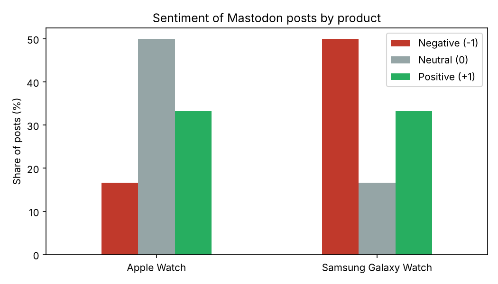

# Smartwatch Sentiment Pipeline: Apple Watch vs. Samsung Galaxy Watch

A Python project that collects public Mastodon posts about smartwatches, cleans them, stores them in a SQL database and compares how people feel about the **Apple Watch** and the **Samsung Galaxy Watch**.

```
Mastodon ──► collect ──► clean ──► SQL ──► sentiment (-1 / 0 / +1) ──► chart
```

I first built this as a university project, which I led, and later rebuilt and extended it on my own.

## How it works

| Step | File | What it does |
|---|---|---|
| 1. Collect | `src/collect.py` | Gets posts from Mastodon for the hashtags in `config/search_terms.txt` |
| 2. Clean | `src/clean.py` | Removes HTML, links, @mentions, duplicates and very short posts, and tags each post as Apple or Samsung |
| 3. Store | `src/load_sql.py` | Saves the clean posts in a SQLite table, `posts_clean` |
| 4. Sentiment | `src/sentiment.py` | Labels each post negative (-1), neutral (0) or positive (+1) with VADER |
| 5. Report | `src/report.py` | Compares the two products with SQL and saves a chart |

## Run it

```bash
pip install -r requirements.txt
python run_pipeline.py --sample
```

This runs on a small sample file included in the project, so no account is needed.

To use real data:

1. Create a Mastodon token: **Preferences → Development → New application**, with the `read` scope only.
2. Copy `.env.example` to `.env` and paste your token there. `.env` is never uploaded.
3. Run:

```bash
python run_pipeline.py --pages 3
```

## Example result



*This chart is from the small sample file, not real data.*

## Tools

Python · pandas · Mastodon.py · BeautifulSoup · SQLite · VADER · Matplotlib
